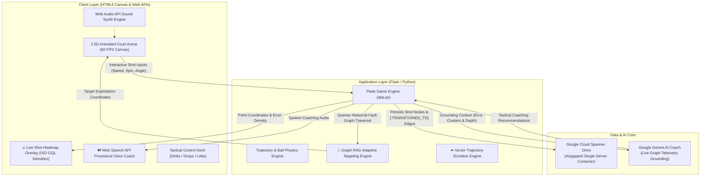

# Elevating On-Device Graph RAG: Building an Adaptive Tactical Arena with Spanner Omni & Gemini 🏓
### *Code Vipassana Season 16 — Project Pioneer Major Architectural Evolution*

**Author:** Snehal Ghadge  
**GitHub Repository:** [spanner-omni-pickleball](https://github.com/snehalghadge59-blip/spanner-omni-pickleball)  
**Track:** Code Vipassana Season 16: *Data & AI for Airgapped Systems*

---

## 1. Executive Summary & Problem Context

Regulated industries and airgapped field deployments (defense, healthcare, smart stadiums, and edge factories) face an architectural dilemma: modern intelligent agents typically require a fragmented cluster of specialized databases:
- **Relational SQL** for ACID match state, scoring, and facilities reservations.
- **Graph Databases (e.g. Neo4j)** for relationship transitions and spatial trajectory tracking.
- **Vector Engines** for grounding context retrieval into LLMs.

This codelab evolution demonstrates how **Google Cloud Spanner Omni** unifies relational and property graph models (`ISO GQL`) on a single engine running in single-server airgapped mode, providing sub-millisecond local latency with zero external cloud dependencies.

Building upon the initial Code Vipassana Session 3 codelab (*"Data Agents & GraphRAG On-Device with Spanner Omni"*), this **Project Pioneer** evolution elevates the architecture into a **self-optimizing, adaptive sports simulation arena** featuring **live ISO GQL shot heatmaps**, **on-device Graph RAG opponent counter-intelligence**, and **procedural Web Speech API tactical coaching**.

---

## 2. System Architecture & Component Interaction



---

## 3. Four Major Architectural Evolutions (What Makes This Truly Pioneer)

### 🚀 Evolution 1: Live Court Shot Heatmap & Error Density Layer (ISO GQL)
- **Codelab Baseline:** Stored basic relational table entries and executed manual command-line queries.
- **Pioneer Evolution:** Built an interactive visual heatmap layer directly on the 2.5D court canvas. The frontend queries `/api/analytics/heatmap`, which traverses the shot property graph (`MATCH (s:Shot)-[:TRANSITIONED_TO]->(r:Shot)`), computing radial density heat halos across court zones (NVZ Kitchen, Midcourt, and Deep Baseline) to visually expose winning landing spots versus unforced error clusters in real-time.

### 🧠 Evolution 2: On-Device Graph RAG Adaptive Opponent (OmniBot AI)
- **Codelab Baseline:** Static opponent returning scripted counter-shots based only on the current ball type.
- **Pioneer Evolution:** Introduced a machine learning graph-traversal engine (`/api/analytics/adaptive-bot-target`). OmniBot actively queries Spanner Omni's telemetry graph to identify the human player's specific defensive vulnerability (e.g., 68% error rate on backhand baseline slices vs. NVZ foot faults). When Adaptive AI mode is active, OmniBot deliberately recalibrates its trajectory coordinates to exploit that identified weakness.

### 🔊 Evolution 3: Web Speech API Procedural Voice AI Coach
- **Codelab Baseline:** Text-only coaching prompts displayed in a static chat box.
- **Pioneer Evolution:** Embedded real-time procedural speech synthesis using the browser's native `window.speechSynthesis`. Gemini's tactical coaching analysis and referee decisions are spoken aloud in real time at the conclusion of every continuous rally, accompanied by a dynamic audio wave visualizer.

### ⏪ Evolution 4: 3D Vector Trajectory Rally Replay Scrubber
- **Codelab Baseline:** Rallies disappeared once completed.
- **Pioneer Evolution:** Implemented a rally trace recorder (`/api/analytics/replay-last`) that captures full 2D coordinate pairs `(fromX, fromY) -> (toX, toY)` across each exchange. Players can trigger the Replay button to watch the ball re-trace its quadratic bezier curve with numbered waypoint markers (`S1, S2, ...`) directly on the court canvas.

---

## 4. How to Run Locally in Airgapped Mode

### 1. Clone & Bootstrap
```bash
git clone https://github.com/snehalghadge59-blip/spanner-omni-pickleball.git
cd spanner-omni-pickleball
chmod +x start.sh
./start.sh
```

### 2. Docker Container Execution
```bash
# Build the self-contained container
docker build -t spanner-omni-pickleball .

# Run in airgapped single-server mode
docker run -p 5000:5000 spanner-omni-pickleball
```

Access the interactive arena at `http://localhost:5000`.

---

## 5. Conclusion & Code Vipassana Learnings

Code Vipassana Season 16 challenged developers to think beyond traditional cloud-only architectures and master **Data & AI for Airgapped Systems**. By pairing **Google Cloud Spanner Omni's** relational + property graph dual capabilities with **Google Gemini's** tactical reasoning, this project demonstrates how mission-critical simulation, gaming, and edge IoT platforms can achieve enterprise ACID consistency and intelligent autonomy without ever touching the public internet.
