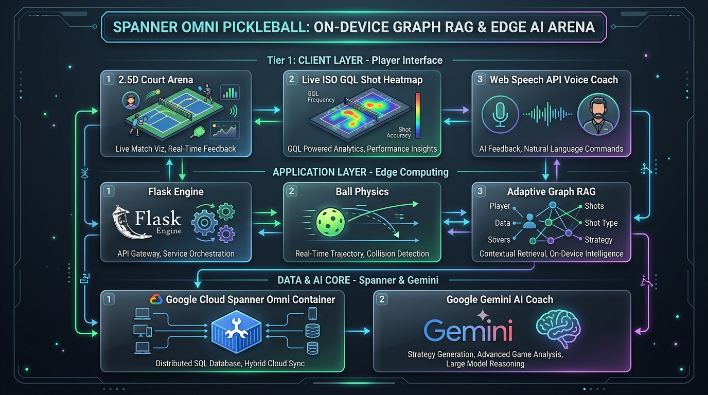
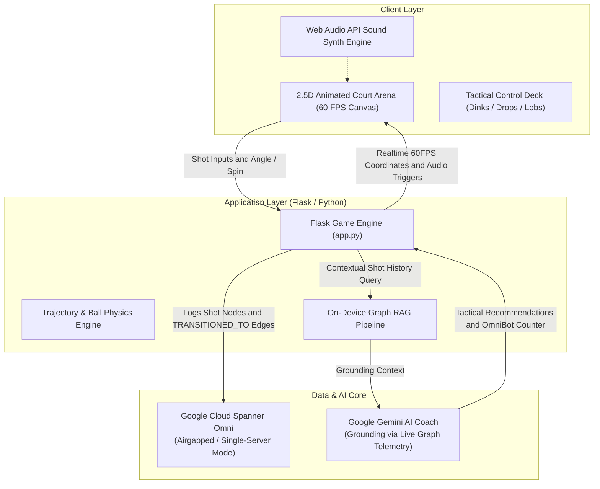

# Spanner Omni Pickleball Game 🏓
### *Data & AI for Airgapped Systems — Code Vipassana Season 16 Project Pioneer*

[](https://cloud.google.com/spanner)
[](https://ai.google.dev/)
[](https://flask.palletsprojects.com/)
[](https://www.docker.com/)

An interactive, visual **Pickleball Tactical Game Arena** demonstrating **On-Device Graph RAG** and distributed ACID consistency with **Google Cloud Spanner Omni** combined with **Google Gemini** for tactical coaching and real-time counter-shot prediction.

Built for **Code Vipassana Season 16: Data & AI for Airgapped Systems**.

---

## 🏛️ System Architecture





---

## 🎮 Key Highlights & Features (Project Pioneer Major Evolutions)

- **🔥 Live Court Shot Heatmap & Fault Density Layer (ISO GQL Query)**:
  - Real-time radial heat gradient visualization directly on the 2.5D tournament court canvas.
  - Queries Spanner Omni Graph telemetry (`MATCH (s:Shot)-[:TRANSITIONED_TO]->(r:Shot)`) to highlight winner zones (emerald) and unforced error/fault clusters (orange/red) with live zone distribution analytics.
- **🧠 Adaptive OmniBot AI (On-Device Graph RAG Opponent)**:
  - Dynamically traverses historical shot and fault nodes in Spanner Omni to pinpoint the player's primary defensive vulnerability (e.g., weak backhand baseline returns, kitchen NVZ foot faults).
  - Actively adapts counter-shot coordinates in real-time to challenge the player's weaknesses.
- **🔊 Web Speech API Tactical Voice Coach**:
  - Live procedural speech synthesis speaking referee outcomes and Gemini tactical coaching feedback aloud during matches without external cloud TTS dependencies.
- **⏪ Vector Trajectory Rally Replay Scrubber**:
  - Step-by-step 3D quadratic bezier trajectory visualizer with numbered waypoint markers (`S1, S2, ...`) allowing players to review prior exchanges directly from Spanner.
- **2.5D Animated Visual Court Arena (60 FPS Canvas)**: Pure HTML5 Canvas rendering of a tournament court with 60 FPS wiffle ball trajectory physics, bounce detection, and kitchen line infractions.
- **On-Device Spanner Omni Graph Telemetry**: 
  - Every rally, shot, bounce, and counter-response is recorded as relational graph nodes (`s1:Shot`, `s2:Shot`) with `[:TRANSITIONED_TO]` edges in Spanner Omni.
  - Demonstrates enterprise airgapped transactional consistency and query speed without requiring external cloud DB dependencies.
- **Gemini Agentic Tactical Coach**:
  - Leverages live Spanner Omni telemetry to analyze opponent shot patterns, player positioning, and error rates.
  - Generates tactical coaching adjustments (e.g., target backhand kitchen corner, reduce attack angle).
- **Web Audio API Effects**:
  - Dynamic audio synthesized in real time (paddle pops, court bounce thuds, and speedup swooshes).
- **Four Distinct Shot Categories**:
  - Kitchen Soft Dinks, 3rd-Shot Drops, Shoulder Speedups, and Defensive Lobs.

---

## 📂 Project Structure

```
pickleball/
├── app.py                  # Flask backend, Spanner transactions & Gemini AI integration
├── requirements.txt        # Python dependencies
├── Dockerfile              # Container definition for airgapped deployment
├── start.sh                # Automated bootstrap script
├── .env.example            # Environment variables template
├── .gitignore              # Git ignore rules for safety
├── README.md               # Architecture, features, and setup documentation
└── templates/
    └── index.html          # 2.5D visual animated court arena & control deck
```

---

## 🚀 Quick Start Guide

### 1. Install Dependencies
```bash
pip install -r requirements.txt
```

### 2. Configure Environment
Copy `.env.example` to `.env`:
```bash
cp .env.example .env
```
Set your `GEMINI_API_KEY` and Spanner parameters if needed.

### 3. Run Spanner Omni (Docker)
```bash
# Create persistent storage volume
docker volume create spanner_omni_data

# Pull Spanner Omni image
docker pull us-docker.pkg.dev/spanner-omni/images/spanner-omni:2026.r2.1-beta

# Run Spanner Omni in single-server mode
docker run -d --name spanner-omni \
  -p 9010:9010 -p 9020:9020 \
  -v spanner_omni_data:/spanner \
  us-docker.pkg.dev/spanner-omni/images/spanner-omni:2026.r2.1-beta \
  start-single-server
```

### 4. Launch the Game Arena
```bash
python app.py
```
Open your browser at `http://localhost:5000` (or the Google Cloud Shell Web Preview on port 5000).

---

## 👨‍💻 Author
- **Snehal Ghadge**
- Code Vipassana Season 16: *Data & AI for Airgapped Systems*
